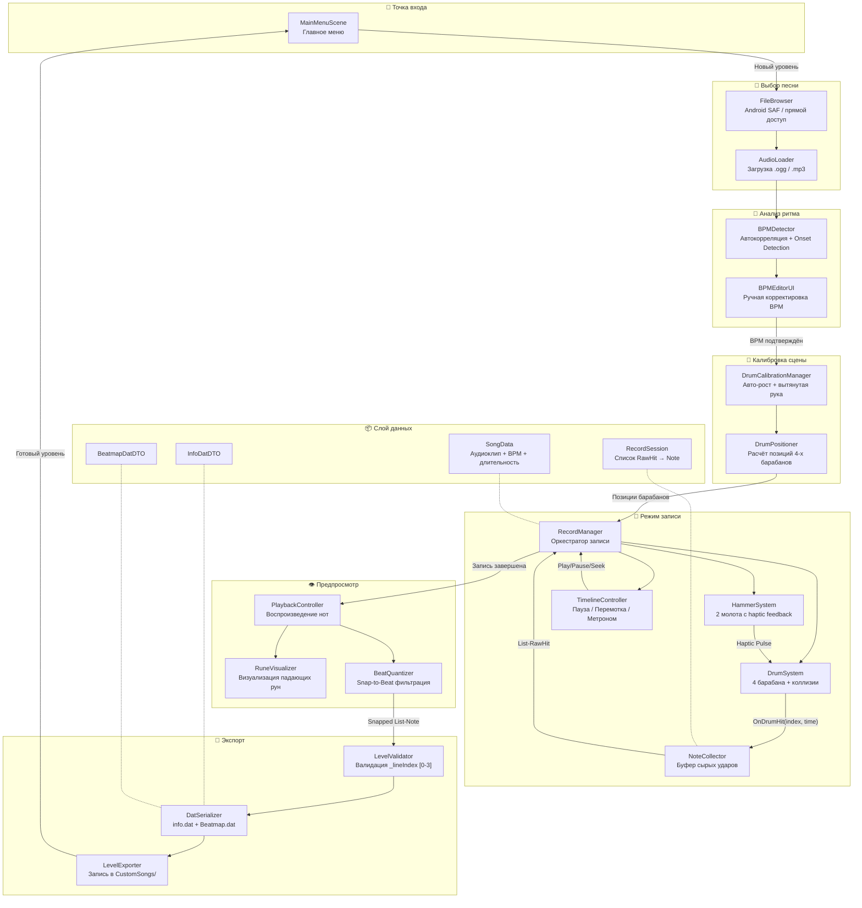

# Архитектура VR-конструктора уровней для Ragnarock (Quest 3)

## 1. Технический стек

| Компонент | Выбор | Обоснование |
|-----------|-------|-------------|
| **Unity** | 2022.3 LTS | Стабильная LTS-ветка, полная поддержка Quest 3 |
| **VR Framework** | XR Interaction Toolkit 2.x + OpenXR | Кроссплатформенность, готовые компоненты взаимодействия, активная поддержка Unity |
| **Сериализация** | Newtonsoft.Json (JSON.NET) | Гибкая работа с JSON, поддержка `[JsonProperty]`, кастомные конвертеры |
| **Аудио-анализ** | Собственная реализация BPM-детекции (Autocorrelation + Onset Detection) | Ни один бесплатный ассет не даёт стабильного результата на Quest; кастомный подход через Unity AudioClip.GetData() |
| **Рендеринг** | URP (Universal Render Pipeline) | Оптимальный баланс качества/производительности для мобильного VR |
| **UI** | Unity UI (Canvas) + XR Interaction (XR Ray Interactor) | Мировой канвас (World Space) для VR-интерфейсов |

---

## 2. Архитектурная диаграмма (Mermaid)



---

## 3. Пространственная конфигурация VR-сцены (Drakkar Deck)

### 3.1 Контекст: позиция игрока в Ragnarock

В оригинальной игре игрок стоит на **корме драккара** (хвост лодки). Перед ним, на палубе, в ряд установлены **4 барабана** — на уровне пояса, с небольшим наклоном к игроку. Барабаны расставлены полукругом/в линию, так чтобы до каждого можно было дотянуться молотом не сходя с места.

```
          Вид сверху:
          
   🪘======🪘======🪘======🪘    ← 4 барабана в ряд (на палубе)
   Drum0   Drum1   Drum2   Drum3
   
              🧍                  ← Игрок (на корме)
           (XR Origin)
```

### 3.2 Параметры позиционирования барабанов (DrumLayoutConfig)

```csharp
[CreateAssetMenu(menuName = "Ragnarock Editor/Drum Layout Config")]
public class DrumLayoutConfig : ScriptableObject
{
    [Header("Позиция относительно XR Origin (игрока)")]
    [Tooltip("Расстояние от игрока до линии барабанов (вперёд)")]
    public float DistanceFromPlayer = 0.8f;    // 80 см вперёд

    [Tooltip("Высота центра барабанов относительно пола")]
    public float DrumHeight = 0.9f;            // ~90 см (уровень пояса)

    [Tooltip("Общая ширина расстановки 4-х барабанов")]
    public float TotalWidth = 1.6f;            // 160 см (по 40 см на барабан)

    [Header("Радиус полукруга (опционально)")]
    [Tooltip("0 = ровная линия; >0 = изгиб полукругом к игроку")]
    public float ArcRadius = 0.3f;             // Лёгкий полукруг

    [Header("Наклон поверхности барабана к игроку")]
    [Tooltip("Угол наклона в градусах (0 = строго вверх, 15 = наклон к игроку)")]
    public float DrumTiltAngle = 10f;

    [Header("Размер одного барабана")]
    public float DrumDiameter = 0.35f;         // 35 см
    public float DrumHeightSize = 0.15f;       // 15 см высота корпуса

    [Header("Пресет")]
    public string PresetName = "Стандартный";
}
```

### 3.3 Система калибровки под игрока (DrumCalibrationManager)

**Проблема:** Игроки разного роста, с разной длиной рук, по-разному ощущают комфортное расстояние до барабанов. Нужна калибровка перед началом записи.

**Решение:** Двухэтапная калибровка при первом входе в RecordScene (с возможностью пропуска и сохранения профиля):

#### Этап 1: Калибровка роста
- Игрок стоит прямо, руки опущены
- Система считывает `XROrigin.Camera.transform.position.y` (высота головы)
- Вычисляется примерный рост: `playerHeight ≈ headY + 0.12f` (12 см от макушки до глаз)
- `DrumHeight = playerHeight * 0.55f` (примерно уровень пояса = 55% роста)
- Сохраняется в `PlayerPrefs`

#### Этап 2: Калибровка вытянутой руки
- Игрок вытягивает руку с контроллером вперёд (на комфортное расстояние удара)
- Система замеряет расстояние от головы до контроллера: `Vector3.Distance(head.position, rightController.position)`
- `DistanceFromPlayer = measuredDistance - DrumDiameter * 0.5f`
- Это гарантирует, что все 4 барабана будут в зоне досягаемости

#### Интерфейс калибровки:
```
┌──────────────────────────────────┐
│  🎯 КАЛИБРОВКА БАРАБАНОВ        │
│                                  │
│  Встаньте прямо, опустите руки   │
│  [████████░░░░] измерение...     │
│                                  │
│  Теперь вытяните правую руку     │
│  вперёд на удобное расстояние    │
│  и нажмите ТРИГГЕР               │
│                                  │
│  Расстояние: 0.82 м              │
│  Высота барабанов: 0.88 м        │
│                                  │
│  [ ПРОПУСТИТЬ ]  [ СОХРАНИТЬ ]   │
└──────────────────────────────────┘
```

### 3.4 DrumPositioner — расчёт позиций 4-х барабанов

```csharp
public class DrumPositioner : MonoBehaviour
{
    public DrumLayoutConfig Config;
    public Transform XROrigin;

    // Вычисляет мировые позиции для 4 барабанов (индексы 0-3)
    public Vector3[] CalculateDrumPositions()
    {
        Vector3[] positions = new Vector3[4];
        Vector3 baseForward = XROrigin.forward;
        Vector3 baseRight = XROrigin.right;
        Vector3 playerPos = XROrigin.position;
        
        float halfWidth = Config.TotalWidth * 0.5f;
        float spacing = Config.TotalWidth / 3f; // Расстояние между центрами

        for (int i = 0; i < 4; i++)
        {
            // Линейная позиция (без дуги)
            float xOffset = -halfWidth + i * spacing;
            Vector3 linearPos = playerPos
                + baseForward * Config.DistanceFromPlayer
                + baseRight * xOffset;
            linearPos.y = Config.DrumHeight; // Высота от пола

            // Применяем дугу (полукруг), если ArcRadius > 0
            if (Config.ArcRadius > 0.001f)
            {
                float t = (i - 1.5f) / 1.5f; // -1 до +1
                float angle = t * Mathf.PI * 0.25f; // ±45°
                float arcX = Mathf.Sin(angle) * Config.ArcRadius;
                float arcZ = Mathf.Cos(angle) * Config.ArcRadius;
                linearPos += baseRight * arcX + baseForward * (arcZ - Config.ArcRadius);
            }

            positions[i] = linearPos;
        }
        return positions;
    }

    // Вычисляет поворот для барабана (наклон к игроку)
    public Quaternion GetDrumRotation()
    {
        return Quaternion.Euler(Config.DrumTiltAngle, 0f, 0f);
    }
}
```

### 3.5 Визуализация сцены (как это выглядит)

```
                   Вид сбоку:
    
    🧍 Игрок           🪘 Барабан (наклонён к игроку)
     |                 /
     |                /  ← угол наклона 10°
     |               /
     |              ┌────┐
     |   ≈80см     │    │  ← высота ~90см (пояс)
     |             │    │
    ─┼─────────────┼────┼────────── пол (Y=0)
     |             │    │
     |             └────┘
    ─┴── ступни


                   Вид сверху (с дугой):
    
         ┌──┐   ┌──┐   ┌──┐   ┌──┐
         │0 │   │1 │   │2 │   │3 │   ← полукруг (ArcRadius=0.3м)
         └──┘   └──┘   └──┘   └──┘
           ＼    │    │    ／
            ＼   │    │   ／
             ＼  │    │  ／
              ╲ │    │ ╱
                🧍
```

### 3.6 Сохранение профиля калибровки

```csharp
// DrumCalibrationProfile — сохраняется в PlayerPrefs (JSON)
[Serializable]
public class DrumCalibrationProfile
{
    public float PlayerHeight;          // Рост игрока (м)
    public float DistanceToDrums;       // Расстояние до барабанов (м)
    public float DrumHeight;            // Высота барабанов (м)
    public float TotalWidth;            // Ширина расстановки (м)
    public float ArcRadius;             // Радиус дуги (м)
    public float DrumTiltAngle;         // Угол наклона (градусы)
    public string ProfileName;          // Имя профиля
    public DateTime LastCalibrated;     // Дата калибровки
}
```

Управление профилями:
- **Авто-профиль** — создаётся при калибровке, сохраняется в `PlayerPrefs`
- **Несколько профилей** — для разных пользователей устройства
- **Сброс** — возврат к стандартным настройкам
- **Ручная тонкая настройка** — слайдеры в меню настроек для каждого параметра

---

## 4. Структура папок Unity проекта

```
Assets/
├── RagnarockEditor/                     # Корневая папка проекта
│   ├── Scenes/
│   │   ├── MainMenuScene.unity          # Главное меню
│   │   ├── SongSelectionScene.unity     # Выбор и анализ песни
│   │   ├── RecordScene.unity            # Режим записи (VR)
│   │   └── PreviewScene.unity           # Предпросмотр уровня
│   │
│   ├── Scripts/
│   │   ├── Core/                        # Ядро приложения
│   │   │   ├── GameManager.cs           # Оркестратор сцен
│   │   │   ├── AppConfig.cs             # ScriptableObject с настройками
│   │   │   └── SceneLoader.cs           # Переход между сценами
│   │   │
│   │   ├── Data/                        # Модели данных (DTO)
│   │   │   ├── InfoDatDTO.cs            # info.dat структура
│   │   │   ├── BeatmapDatDTO.cs         # Beatmap.dat структура
│   │   │   ├── SongData.cs              # Данные песни (runtime)
│   │   │   ├── RawHit.cs                # Сырой удар пользователя
│   │   │   ├── RecordSession.cs         # Сессия записи
│   │   │   ├── DrumCalibrationProfile.cs # Профиль калибровки барабанов
│   │   │   └── DrumLayoutConfig.cs      # ScriptableObject конфигурации
│   │   │
│   │   ├── Audio/                       # Аудио-подсистема
│   │   │   ├── AudioLoader.cs           # Загрузка .ogg/.mp3/.wav
│   │   │   ├── BPMDetector.cs           # Алгоритм детекции BPM
│   │   │   ├── OnsetDetector.cs         # Детекция onset'ов (атак)
│   │   │   └── MetronomePlayer.cs       # Звук метронома
│   │   │
│   │   ├── FileSystem/                  # Работа с файлами
│   │   │   ├── FileBrowser.cs           # Браузер файлов на устройстве
│   │   │   ├── SongFileManager.cs       # Копирование/чтение песен
│   │   │   └── CustomSongsExporter.cs   # Экспорт в папку CustomSongs
│   │   │
│   │   ├── VR/                          # VR-взаимодействия
│   │   │   ├── DrumController.cs        # Логика одного барабана
│   │   │   ├── DrumManager.cs           # Управление 4-мя барабанами
│   │   │   ├── HammerController.cs      # Логика молота
│   │   │   ├── DrumHitDetector.cs       # Детекция столкновений молот-барабан
│   │   │   ├── HapticFeedback.cs        # Тактильная отдача
│   │   │   ├── DrumPositioner.cs        # Расчёт позиций 4-х барабанов
│   │   │   └── DrumCalibrationManager.cs # Система калибровки под игрока
│   │   │
│   │   ├── Recording/                   # Система записи
│   │   │   ├── RecordManager.cs         # Главный оркестратор записи
│   │   │   ├── NoteCollector.cs         # Сбор сырых ударов
│   │   │   ├── TimelineController.cs    # Управление временной шкалой
│   │   │   └── MetronomeVisualizer.cs   # Визуализация битов
│   │   │
│   │   ├── Playback/                    # Система предпросмотра
│   │   │   ├── PlaybackController.cs    # Воспроизведение уровня
│   │   │   ├── RuneSpawner.cs           # Спавн рун
│   │   │   ├── RuneVisual.cs            # Визуал + анимация руны
│   │   │   └── DrumHighlight.cs         # Подсветка барабанов
│   │   │
│   │   ├── Quantization/                # Квантование ритма
│   │   │   ├── BeatQuantizer.cs         # Snap-to-Beat алгоритм
│   │   │   ├── BeatGrid.cs              # Сетка битов на основе BPM
│   │   │   └── QuantizeSettings.cs      # ScriptableObject настроек
│   │   │
│   │   ├── Serialization/               # Сериализация .dat
│   │   │   ├── DatSerializer.cs         # Запись info.dat + Beatmap.dat
│   │   │   ├── DatDeserializer.cs       # Чтение существующих уровней
│   │   │   └── LevelValidator.cs        # Валидация перед сохранением
│   │   │
│   │   └── UI/                          # Пользовательский интерфейс
│   │       ├── MainMenuUI.cs            # Главное меню
│   │       ├── SongSelectionUI.cs       # UI выбора песни
│   │       ├── BPMEditorUI.cs           # Редактор BPM
│   │       ├── RecordHUD.cs             # HUD во время записи
│   │       ├── PreviewUI.cs             # UI предпросмотра
│   │       └── MessageBox.cs            # Диалоговые окна
│   │
│   ├── Prefabs/
│   │   ├── VR/
│   │   │   ├── Drum.prefab              # Префаб барабана
│   │   │   ├── Hammer.prefab            # Префаб молота
│   │   │   ├── Rune.prefab              # Префаб руны (для предпросмотра)
│   │   │   └── XR_Rig.prefab            # XR Origin (камера + контроллеры)
│   │   └── UI/
│   │       ├── VR_Button.prefab         # VR-кнопка
│   │       ├── VR_Slider.prefab         # VR-слайдер
│   │       └── VR_Panel.prefab          # VR-панель
│   │
│   ├── ScriptableObjects/
│   │   ├── AppConfig.asset              # Глобальные настройки
│   │   ├── QuantizeSettings.asset       # Настройки квантования
│   │   ├── DrumLayoutConfig.asset       # Конфигурация расположения барабанов
│   │   └── DrumPresets.asset            # Пресеты расположения барабанов
│   │
│   ├── Audio/
│   │   └── SFX/
│   │       ├── metronome_tick.wav       # Звук метронома
│   │       ├── drum_hit_01.wav          # Звук удара по барабану
│   │       └── ui_click.wav             # Звук UI
│   │
│   ├── Materials/
│   │   ├── Drum_Mat.mat                 # Материал барабана
│   │   ├── Hammer_Mat.mat               # Материал молота
│   │   └── Rune_Mat.mat                 # Материал руны
│   │
│   └── Textures/
│       ├── drum_head.png                # Текстура поверхности барабана
│       └── rune_atlas.png               # Атлас рун
```

---

## 5. Модели данных (DTO)

### 5.1 InfoDatDTO.cs
```csharp
[Serializable]
public class InfoDatDTO
{
    [JsonProperty("_version")] public string Version = "2.0.0";
    [JsonProperty("_songName")] public string SongName;
    [JsonProperty("_songSubName")] public string SongSubName = "";
    [JsonProperty("_songAuthorName")] public string SongAuthorName;
    [JsonProperty("_levelAuthorName")] public string LevelAuthorName;
    [JsonProperty("_beatsPerMinute")] public float BeatsPerMinute;
    [JsonProperty("_songTimeOffset")] public float SongTimeOffset = 0f;
    [JsonProperty("_shuffle")] public float Shuffle = 0f;
    [JsonProperty("_shufflePeriod")] public float ShufflePeriod = 0.5f;
    [JsonProperty("_previewStartTime")] public float PreviewStartTime = 30f;
    [JsonProperty("_previewDuration")] public float PreviewDuration = 10f;
    [JsonProperty("_songFilename")] public string SongFilename;
    [JsonProperty("_coverImageFilename")] public string CoverImageFilename;
    [JsonProperty("_environmentName")] public string EnvironmentName = "Midgard";
    [JsonProperty("_songApproximativeDuration")] public int SongApproximativeDuration;
    [JsonProperty("_difficultyBeatmapSets")] 
    public List<DifficultyBeatmapSet> DifficultyBeatmapSets = new();
}

[Serializable]
public class DifficultyBeatmapSet
{
    [JsonProperty("_beatmapCharacteristicName")] 
    public string BeatmapCharacteristicName = "Standard";
    [JsonProperty("_difficultyBeatmaps")] 
    public List<DifficultyBeatmap> DifficultyBeatmaps = new();
}

[Serializable]
public class DifficultyBeatmap
{
    [JsonProperty("_difficulty")] public string Difficulty;
    [JsonProperty("_difficultyRank")] public int DifficultyRank;  // 1-10
    [JsonProperty("_beatmapFilename")] public string BeatmapFilename;
    [JsonProperty("_noteJumpMovementSpeed")] public float NoteJumpMovementSpeed = 14f;
    [JsonProperty("_noteJumpStartBeatOffset")] public float NoteJumpStartBeatOffset = 0f;
}
```

### 5.2 BeatmapDatDTO.cs
```csharp
[Serializable]
public class BeatmapDatDTO
{
    [JsonProperty("_version")] public string Version = "2.0.0";
    [JsonProperty("_customData")] public CustomData CustomData = new();
    [JsonProperty("_events")] public List<object> Events = new();      // Игнорируется
    [JsonProperty("_notes")] public List<Note> Notes = new();
    [JsonProperty("_obstacles")] public List<object> Obstacles = new(); // Игнорируется
}

[Serializable]
public class Note
{
    [JsonProperty("_time")] public float Time;           // В БИТАХ (не секундах!)
    [JsonProperty("_lineIndex")] public int LineIndex;   // 0-3
    [JsonProperty("_lineLayer")] public int LineLayer;   // Всегда 0
    [JsonProperty("_type")] public int Type;             // 0 или 1
    [JsonProperty("_cutDirection")] public int CutDirection = 1; // Всегда 1 (вниз)
}

[Serializable]
public class CustomData
{
    [JsonProperty("_time")] public float Time = 0f;
    [JsonProperty("_BPMChanges")] public List<object> BPMChanges = new();
}
```

### 5.3 Runtime-модели
```csharp
// Сырой удар пользователя (в секундах от начала песни)
public struct RawHit
{
    public float TimeSeconds;   // Момент удара в секундах
    public int DrumIndex;       // 0-3, какой барабан
}

// Данные песни во время выполнения
public class SongData
{
    public AudioClip Clip;
    public float BPM;
    public float DurationSeconds;
    public string FilePath;
    public string SongName;
    public string AuthorName;
}

// Сессия записи (сохраняется между сценами через синглтон)
public class RecordSession
{
    public SongData Song;
    public List<RawHit> RawHits = new();
    public List<Note> QuantizedNotes = new();  // После квантования
    public int DifficultyRank = 3;             // По умолчанию Normal
    public string DifficultyName = "Normal";
}
```

---

## 6. Описание ключевых модулей

### 6.1 BPMDetector (Анализ ритма)

**Алгоритм:**
1. Загрузить AudioClip → получить массив семплов `AudioClip.GetData()`
2. Разбить на частотные полосы (FFT) для выделения ударных (низкие + высокие частоты)
3. Применить **Onset Detection** (Spectral Flux): найти моменты резкого изменения энергии
4. Применить **Autocorrelation** на массиве интервалов между onset'ами для нахождения доминирующего периода
5. Вычислить BPM = 60 / период
6. Предложить пользователю с возможностью ручной корректировки (слайдер + tap-tempo)

**Ограничения Quest 3:** FFT и автокорреляция работают в главном потоке асинхронно (через `IEnumerator` + `ThreadPool`). Точность ±2 BPM на типичных треках.

### 6.2 DrumHitDetector (Детекция ударов)

**Подход:** Использовать `OnTriggerEnter` на барабане + проверка скорости молота.

- Каждый `DrumController` имеет `BoxCollider` (триггер) на поверхности барабана
- `HammerController` имеет `Rigidbody` + `SphereCollider`
- При `OnTriggerEnter` проверяется `hammer.Velocity.magnitude > threshold` (чтобы отличать удар от простого касания)
- Если удар валидный → вызывается `DrumManager.OnDrumHit(int drumIndex, float timeSeconds)`
- **HapticFeedback:** `XRController.SendHapticImpulse(amplitude, duration)` на контроллере молота
- **Audio Feedback:** Проигрывается SFX удара + частицы (VFX)

### 6.2b DrumCalibrationManager (Калибровка сцены)

**Задача:** Адаптировать положение барабанов под конкретного игрока.

**Двухэтапная калибровка:**

**Этап 1 — Авто-рост:**
- Считывается `XROrigin.Camera.transform.position.y` (высота головы)
- Вычисляется примерный рост: `playerHeight ≈ headY + 0.12f`
- `DrumHeight = playerHeight * 0.55f` (≈55% роста = уровень пояса)

**Этап 2 — Зона досягаемости:**
- Игрок вытягивает правую руку вперёд и нажимает триггер
- Замеряется расстояние от головы до контроллера
- `DistanceFromPlayer = measuredDistance - DrumDiameter * 0.5f`
- Это гарантирует, что все 4 барабана будут в комфортной зоне удара

**Интерфейс:** Мировой Canvas перед игроком с инструкциями и индикатором прогресса.

**DrumPositioner** затем рассчитывает мировые позиции для 4 барабанов с учётом:
- `DistanceFromPlayer` (расстояние вперёд)
- `DrumHeight` (высота от пола)
- `TotalWidth` (ширина расстановки)
- `ArcRadius` (опциональный изгиб полукругом)
- `DrumTiltAngle` (наклон поверхности к игроку)

**Сохранение:** Профиль калибровки (`DrumCalibrationProfile`) сохраняется в `PlayerPrefs` как JSON. Поддерживается несколько профилей для разных пользователей устройства.

### 6.3 RecordManager (Оркестратор записи)

**Конечный автомат:**

```
IDLE → COUNTDOWN(3-2-1) → RECORDING → PAUSED → RECORDING → FINISHED → PREVIEW
                                ↑                      |
                                └── REWIND ────────────┘
```

- `COUNTDOWN`: 3-секундный отсчёт перед началом, метроном
- `RECORDING`: `AudioSource.Play()` + приём ударов от `NoteCollector`
- `PAUSED`: `AudioSource.Pause()` + блокировка детекции ударов
- `REWIND`: Перемотка на N секунд назад + удаление «хвоста» сырых ударов из `RecordSession.RawHits`
- `FINISHED`: Автоматически при завершении трека или по нажатию кнопки «Стоп»

**TimelineController** управляет:
- Пауза / Продолжить
- Перемотка назад (на 5 сек) и вперёд (на 5 сек)
- Отображение текущего времени / общей длительности
- Визуализация прогресса (полоса прогресса)

### 6.4 BeatQuantizer (Snap-to-Beat)

**Задача:** Преобразовать сырые удары (`RawHit`, время в секундах) в квантованные ноты (`Note`, время в битах).

**Алгоритм:**
1. Построить **BeatGrid** — массив моментов времени каждого бита: `beatTime[i] = i * 60.0 / BPM`
2. Для каждого `RawHit`:
   - Найти ближайший бит: `nearestBeat = Round(rawHit.TimeSeconds * BPM / 60.0)`
   - Если расстояние до ближайшего бита ≤ `snapThreshold` (настраиваемый, по умолчанию 0.15 сек) → привязать к биту
   - Иначе → оставить как есть (вычислить `_time` в битах напрямую)
3. Преобразовать в `Note`:
   - `_time = nearestBeatTime * BPM / 60.0` (в битах)
   - `_lineIndex = rawHit.DrumIndex`
   - `_lineLayer = 0`
   - `_type = 0`
   - `_cutDirection = 1`
4. Отсортировать по `_time`

**Параметры квантования (QuantizeSettings.asset):**
- `SnapThreshold` (0.05–0.3 сек)
- `SnapDivision` (1/1, 1/2, 1/4, 1/8 — к каким долям привязывать)
- `MinNoteSpacing` (минимальное расстояние между нотами на одном барабане)

### 6.5 PlaybackController (Предпросмотр)

Режим предпросмотра показывает, как руны будут падать на барабаны:
- `RuneSpawner` создаёт руны в соответствии с `BeatmapDatDTO.Notes`
- Руны движутся сверху вниз к барабанам с учётом `_noteJumpMovementSpeed`
- При достижении барабана — анимация удара + звук
- Пользователь может: Play / Pause / Stop / Изменить скорость (0.5x, 1x)
- После просмотра — кнопка «Сохранить» или «Вернуться к редактированию»

### 6.6 LevelValidator (Валидация)

Проверки перед сохранением:
1. `_lineIndex` ∈ {0, 1, 2, 3} для каждой ноты
2. `_lineLayer` == 0
3. `_cutDirection` == 1
4. `_type` ∈ {0, 1}
5. `_time` > 0 и ≤ длительности песни в битах
6. Нет дубликатов (две ноты на одном барабане с одинаковым временем — допустимо только если это разные барабаны)
7. Минимальное количество нот (> 0)
8. `_songApproximativeDuration` > 0
9. `_beatsPerMinute` > 0

### 6.7 FileBrowser (Выбор файлов)

На Quest 3 (Android) доступ к файловой системе:
- **Опция A (рекомендуемая):** Использовать `Application.persistentDataPath` + копировать песни туда через Android File picker intent (плагин `NativeFilePicker` или `SimpleFileBrowser` из Asset Store)
- **Опция B:** Запрашивать разрешение `READ_EXTERNAL_STORAGE` / `READ_MEDIA_AUDIO` и сканировать папку `Music/`
- Поддерживаемые форматы: `.ogg` (приоритетный), `.mp3`, `.wav`, `.m4a`
- Для `.ogg` на Android может потребоваться декодер (плагин или `UnityWebRequest`)

### 6.8 CustomSongsExporter (Экспорт)

Путь экспорта: `Application.persistentDataPath + "/CustomSongs/{SongName}/"`

Копирует/создаёт:
1. `song.ogg` — копия аудиофайла (конвертация в `.ogg` при необходимости)
2. `cover.jpg` — обложка (по умолчанию — сгенерированная заглушка или выбранная пользователем)
3. `info.dat` — сериализованный `InfoDatDTO`
4. `{DifficultyName}.dat` — сериализованный `BeatmapDatDTO`

При подключении Quest к ПК пользователь вручную копирует папку в `Android/data/com.wanadev.ragnarockquest/files/UE4Game/Ragnarock/Ragnarock/Saved/CustomSongs/`

*(Примечание: прямой доступ к `Android/data` на Android 11+ ограничен; можно рассмотреть использование SAF или копирование через ADB)*

---

## 7. Потоки данных

### 6.1 Поток создания нового уровня

```
[MainMenu] → [FileBrowser] → [AudioLoader] → [BPMDetector] → [BPMEditorUI]
    → [RecordScene] → [RecordManager] → [NoteCollector] → [BeatQuantizer]
    → [PreviewScene] → [PlaybackController] → [LevelValidator]
    → [DatSerializer] → [CustomSongsExporter] → [MainMenu]
```

### 6.2 Поток записи (внутри RecordScene)

```
AudioSource.Play()
   │
   ├── OnDrumHit(drumIndex)
   │      │
   │      ├── RawHit { TimeSeconds = AudioSource.time, DrumIndex }
   │      └── NoteCollector.Add(rawHit)
   │
   ├── [Пауза] → AudioSource.Pause() → блокировка OnDrumHit
   │
   ├── [Перемотка -5с] → AudioSource.time -= 5 → NoteCollector.RemoveAfter(AudioSource.time)
   │
   └── [Конец трека] → RecordSession.RawHits → BeatQuantizer.Quantize() → RecordSession.QuantizedNotes
```

### 6.3 Преобразование RawHit → Note (квантование)

```
RawHit { TimeSeconds: 12.347, DrumIndex: 1 }
   │  BPM = 130
   │  BeatInterval = 60/130 ≈ 0.4615 сек
   │  NearestBeatIndex = Round(12.347 / 0.4615) = Round(26.75) = 27
   │  NearestBeatTime = 27 * 0.4615 = 12.461 сек
   │  Distance = |12.347 - 12.461| = 0.114 сек ≤ 0.15 → SNAP
   │
   └── Note { _time: 27.0, _lineIndex: 1, _lineLayer: 0, _type: 0, _cutDirection: 1 }
```

---

## 8. UI/UX дизайн

### 7.1 Главное меню (World Space Canvas перед пользователем)
- **Новый уровень** — запускает поток создания
- **Редактировать уровень** — загружает существующий `.dat`
- **Настройки** — калибровка, громкость, haptic intensity
- **Выход**

### 7.2 Экран анализа BPM
- Отображение waveform (упрощённая)
- Найденный BPM + предложение
- Слайдер для ручной корректировки BPM (60–220)
- Кнопка Tap Tempo (настучать ритм для уточнения)
- Кнопка «Продолжить»

### 7.3 HUD во время записи (на «запястье» или над барабанами)
- Текущее время / общая длительность
- Полоса прогресса
- Кнопки: Пауза ⏸, Перемотка назад ⏪ (на 5 сек), Стоп ⏹
- Счётчик ударов по каждому барабану
- Визуальная индикация битов (пульсирующая иконка)

### 7.4 Экран предпросмотра
- Вид на 4 барабана + падающие руны
- Кнопки: Play ▶, Пауза ⏸, Скорость 0.5x/1x
- Кнопки: «Сохранить уровень» / «Редактировать»
- Настройки Snap-to-Beat (Threshold, Division)

---

## 9. Что было упущено пользователем (дополнительные фичи)

1. **Метроном во время записи** — звуковой + визуальный (пульсация)
2. **Отсчёт 3-2-1** перед началом записи
3. **Тактильная отдача (Haptic)** при ударе по барабану
4. **Визуальная обратная связь** — частицы/свечение при ударе, анимация барабана
5. **Калибровка задержки аудио** — компенсация latency (важно для VR)
6. **Редактирование существующих уровней** — загрузка `.dat` и добавление/удаление нот
7. **Tap Tempo** — возможность настучать BPM вручную
8. **Валидация перед сохранением** — проверка корректности данных
9. **Undo во время записи** — отмена последнего действия (перемотка с удалением нот)
10. **Авто-калибровка барабанов под игрока** — двухэтапная: замер роста + зоны досягаемости руки
11. **Ручная тонкая настройка барабанов** — слайдеры: расстояние, высота, ширина, наклон, дуга
12. **Сохранение профилей калибровки** — несколько профилей для разных пользователей
13. **Множественные сложности** — возможность создать Normal + Expert за один сеанс
14. **Авто-сохранение черновика** — чтобы не потерять прогресс
15. **Локализация** — русский + английский интерфейс
16. **Туториал** — обучение при первом запуске
17. **Спектрограмма/волновая форма** при редактировании BPM
18. **Экспортная проверка** — предупреждение если файл .ogg слишком большой или не того формата

---

## 10. Ключевые технические риски

| Риск | Влияние | Митигация |
|------|---------|-----------|
| **Точность BPM-детекции** на Quest 3 | Высокое | Реализовать tap-tempo как fallback; дать ручную корректировку |
| **Задержка аудио** (Android latency) | Среднее | Калибровка смещения в настройках; использовать `AudioSettings.dspTime` |
| **Доступ к файловой системе** Android 11+ | Среднее | Использовать `SimpleFileBrowser` плагин; копировать в `persistentDataPath` |
| **Производительность** при рендеринге рун | Низкое | Object Pooling для рун; URP + простые меши |
| **Декодирование .ogg** на Android | Среднее | Использовать Unity `UnityWebRequestMultimedia.GetAudioClip()` или конвертировать заранее |
| **Точность детекции ударов** (ложные срабатывания) | Среднее | Порог скорости молота + debounce (минимальный интервал между ударами на одном барабане) |

---

## 11. Порядок реализации (рекомендуемый)

1. **Project Setup** — Unity 2022.3 LTS + XR Interaction Toolkit + OpenXR + URP
2. **Data Models** — DTO классы + тесты сериализации
3. **File Management** — загрузка аудио, браузер файлов
4. **Audio Analysis** — BPM детектор + UI редактор BPM
5. **VR Drum System** — префабы барабанов/молотов, детекция ударов, haptic
6. **Drum Calibration** — DrumCalibrationManager, DrumPositioner, калибровка под игрока
7. **Recording System** — RecordManager, NoteCollector, TimelineController
8. **Playback & Preview** — RuneSpawner, PlaybackController
9. **Quantization** — BeatQuantizer, BeatGrid
10. **Serialization & Export** — DatSerializer, LevelValidator, CustomSongsExporter
11. **UI Polish** — все экраны, анимации, звуки
12. **Testing & Bug Fixing** — на реальном Quest 3
13. **Polish** — VFX, метроном, туториал, локализация
